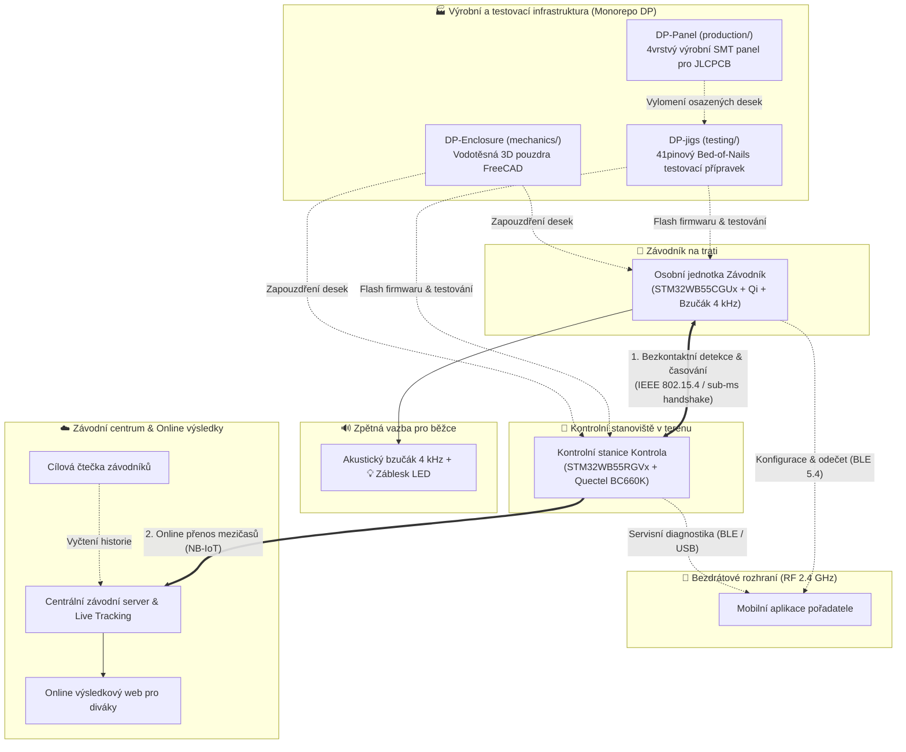

# Diplomová práce – Systém kontrolních stanovišť a osobních jednotek pro orientační sporty

> Komplexní hardwarový a softwarový ekosystém pro měření mezičasů a bezdrátový přenos dat při orientačních a vytrvalostních závodech (orientační běh, MTBO, lyžařský orientační běh). Systém využívá časování a vzájemnou rádiovou komunikaci dle standardu **IEEE 802.15.4**, Bluetooth Low Energy (BLE) pro konfiguraci a servisní odečet, bezdrátové indukční nabíjení standardu Qi a vzdálený přenos mezičasů do závodního centra přes úzkopásmovou síť **NB-IoT** (Narrowband IoT).

**Autor:** Ing. Josef Nagy  
**Instituce:** České vysoké učení technické v Praze (Fakulta elektrotechnická)  
**Stav projektu:** Dokončeno a ověřeno (HW Revize 2.1 / FW v1.24) | **Licence:** Open Source / Akademické využití

---

## 1. Účel a řešený problém

Tradiční systémy pro orientační běh vyžadují fyzický kontakt čipu závodníka s kontrolní stanicí (kontaktní ražení) nebo využívají proprietární rádiové protokoly s omezeným dosahem a bez možnosti přímého online přenosu průběžných mezičasů z lesa do cílového prostoru.

Tento projekt přináší moderní modulární řešení:
1. **Základnová kontrolní stanice (Kontrola):** Stacionární jednotka umístěná na kontrolním bodě v terénu. Detekuje průchod závodníků bezkontaktně v rádiovém poli IEEE 802.15.4 (dosah 0.5 až 2 m), zaznamenává přesný čas průchodu s milisekundovou stabilitou (synchronizovaný krystal LSE) a odesílá mezičasy přes celulární síť NB-IoT na server pořadatele.
2. **Osobní jednotka závodníka (Závodník):** Kompaktní, lehká a odolná nositelná jednotka nošená běžcem na ruce, prstu či řídítkách kola. Při průchodu kontrolním bodem provede záznam do interní paměti a poskytne závodníkovi okamžitou akustickou (4 kHz piezo) a vizuální (LED) zpětnou vazbu.
3. **Výrobní a testovací infrastruktura:** Integrovaný technologický panel pro sériové SMT osazení (`production/`) a jehličkový programovací přípravek Bed-of-Nails (`testing/`) pro rychlé nahrání firmwaru a testování.
4. **Hermetické provedení pouzder:** 3D mechanické konstrukce krabiček (`mechanics/`) optimalizované pro venkovní použití s integrovaným Qi bezdrátovým nabíjením eliminujícím vnější konektory.

---

## 2. Systémová architektura

Následující diagram znázorňuje kompletní architekturu celého systému od detekce průběhu až po výrobu a testování:



---

## 3. Struktura repozitáře (Monorepo)

Repozitář sdružuje veškeré zdrojové kódy firmwaru, hardwarové návrhy desek, výrobní panelizaci, testovací přípravky i mechanické modely pouzder:

```text
DP/
├── hardware/
│   ├── DP-Kontrola/            # [PRJ-10] Zdrojový HW návrh kontrolní stanice (KiCad 8/9)
│   │   ├── DP-Kontrola.kicad_pro / kicad_sch / kicad_pcb
│   │   ├── MCU.kicad_sch, NB-IoT-module.kicad_sch, wireless-charger.kicad_sch
│   │   ├── DP-Kontrola-*.gbr / drl / dxf / step (Výrobní a 3D podklady)
│   │   └── README.md           # Podrobná technická dokumentace desky Kontrola
│   └── DP-Zavodnik/            # [PRJ-11] Zdrojový HW návrh osobní jednotky (KiCad 8/9)
│       ├── DP-Zavodnik.kicad_pro / kicad_sch / kicad_pcb
│       ├── MCU.kicad_sch, wireless-charger.kicad_sch, signaling.kicad_sch
│       ├── DP-Zavodnik-*.dxf / step / pdf (Výrobní a 3D podklady)
│       └── README.md           # Podrobná technická dokumentace desky Závodník
│
├── Kontrola_Syst/              # C / HAL Firmware stanice Kontrola (STM32CubeIDE)
│   ├── Core/                   # Aplikační logika (M4): main.c, app_entry.c, RTC, flash logger
│   ├── STM32_WPAN/             # Wireless middleware (M0+): BLE, 802.15.4 MAC, app_nbiot.c
│   ├── Drivers/                # CMSIS a STM32WBxx HAL drivery
│   └── Kontrola_Syst.ioc       # Projekt STM32CubeMX
│
├── Zavodnik_Syst/              # C / HAL Firmware jednotky Závodník (STM32CubeIDE)
│   ├── Core/                   # Aplikační logika (M4): stavový automat, bzučák 4 kHz, LPM
│   ├── STM32_WPAN/             # Bezdrátový zásobník IEEE 802.15.4 a BLE
│   ├── Drivers/                # CMSIS a STM32WBxx HAL drivery
│   └── Zavodnik_Syst.ioc       # Projekt STM32CubeMX
│
├── production/                 # [PRJ-12] Výrobní panelizace plošných spojů (DP-Panel)
│   ├── DP-Panel.kicad_pcb      # Sdružený 4vrstvý výrobní panel (114.05 × 77.55 mm)
│   ├── DP-Panel-job.gbrjob     # Gerber job s definicí stackupu Nan-Ya NP-155FR
│   ├── fab-data/               # Kompletní výrobní balíček (Gerber, BOM s LCSC ID, CPL)
│   └── README.md               # Dokumentace výrobního panelu pro SMT linku
│
├── testing/                    # [PRJ-13] Testovací a flashovací přípravek (DP-jigs)
│   ├── DP-jigs.kicad_pcb / sch # 2vrstvá deska Bed-of-Nails testeru
│   ├── fab-data/               # Výrobní data přípravku pro výrobu
│   └── README.md               # Dokumentace testeru a postup oživování
│
├── mechanics/                  # [PRJ-15] 3D konstrukce krabiček a pouzder (DP-Enclosure)
│   ├── DP-Kontrola.FCStd       # Parametrický 3D model krabičky Kontrola ve FreeCADu
│   ├── *.png                   # 15 fotorealistických renderů pohledů a řezů
│   └── README.md               # Návod na 3D tisk a montáž pouzder
│
├── .gitignore                  # Ochrana před commitem build artefaktů, záloh a cache
└── README.md                   # Tato hlavní přehledová dokumentace monorepa
```

---

## 4. Klíčové hardwarové komponenty a subsystémy

Obě jednotky sdílejí společnou architekturu postavenou na mikrokontrolérech STMicroelectronics a správě napájení Texas Instruments:

| Subsystém | Jednotka Kontrola | Jednotka Závodník |
| :--- | :--- | :--- |
| **Řídící mikrokontrolér** | **STM32WB55RGVx** (VFQFPN68)<br/>Dual Core Cortex-M4 + M0+ | **STM32WB55CGUx** (UFQFPN48)<br/>Kompaktní miniaturní pouzdro |
| **RF komunikace** | 2.4 GHz IEEE 802.15.4 & BLE 5.4,<br/>integrovaná PCB anténa | 2.4 GHz IEEE 802.15.4 & BLE 5.4,<br/>integrovaná PCB anténa |
| **Celulární telemetrie** | **Quectel BC660K-GL** (NB-IoT modem)<br/>externí anténa SMA / u.FL | *Není osazeno (přenos přes Kontrolu)* |
| **Bezdrátové nabíjení** | **TI BQ51013BRHLR** (Qi přijímač 5 W) | **TI BQ51013BRHLR** (Qi přijímač 5 W) |
| **Správa nabíjení & Power-Path** | **TI BQ24232RGTR** (až 500 mA) | **TI BQ24232RGTR** (přizpůsobeno Li-Po) |
| **Hlavní step-down měnič** | **TI TPS62842DGRR** ($I_Q \approx 60\text{ nA}$) | **TI TPS62842DGRR** ($I_Q \approx 60\text{ nA}$) |
| **Napájení modemu** | **TI TPS628502QDRLRQ1** (2 A buck) | *Není přítomno* |
| **Zpětná vazba pro uživatele** | RGB stavové LED, bzučák, USB CDC | Vysoce svítivé LED, 4 kHz piezo driver |
| **Deska plošných spojů** | 4 vrstvy FR4, ENIG zlacení | 4 vrstvy FR4, zaoblený nositelný tvar |

---

## 5. Softwarová architektura a bezdrátový zásobník

Firmware běží na dvoujádrovém mikrokontroléru řady STM32WB:
- **CPU1 (ARM Cortex-M4 @ 64 MHz):** Běh uživatelské aplikace, sekvencer událostí `UTIL_SEQ`, obsluha RTC časovače, správa energetických režimů (Sleep/Stop mode), zápis do Flash paměti (`flash_logger.c`), řízení NB-IoT FIFO fronty a USB komunikace.
- **CPU2 (ARM Cortex-M0+ @ 32 MHz):** Vyhrazený bezdrátový koprocesor. Vyžaduje nahrání binárního firmwaru ST `stm32wb5x_Ble_Mac_802_15_4_fw.bin`. Zajišťuje bezdrátovou obsluhu na nejnižší vrstvě PHY/MAC v reálném čase bez zatížení aplikačního jádra.
- **Mezijádrová komunikace:** Realizována pomocí hardwarového řadiče IPCC (Inter-Processor Communication Controller) a sdílené paměti RAM.

---

## 6. Návod na zprovoznění a vývoj

### A. Vývoj a úprava hardwaru (KiCad)
1. Nainstalujte **KiCad EDA v8.0** nebo novější (testováno i na KiCad 9).
2. Otevřete projekt `hardware/DP-Kontrola/DP-Kontrola.kicad_pro` nebo `hardware/DP-Zavodnik/DP-Zavodnik.kicad_pro`.
3. Všechny knihovny symbolů a footprintů jsou uloženy v projektu nebo odpovídají standardní KiCad knihovně.
4. Výrobní Gerbery a vrtací podklady jsou vygenerovány ve složkách jednotlivých desek a v modulu `production/`.

### B. Překlad firmwaru (STM32CubeIDE)
1. Otevřete **STM32CubeIDE** (testováno na verzi 1.15+).
2. Zvolte `File -> Import... -> Existing Projects into Workspace` a načtěte složky `Kontrola_Syst` a `Zavodnik_Syst`.
3. Před prvním spuštěním nového mikrokontroléru nahrajte do koprocesoru bezdrátový zásobník:
   - Spusťte nástroj **STM32CubeProgrammer**.
   - Připojte desku přes programátor ST-LINK (SWD rozhraní na testovacím přípravku `testing/`).
   - Přejděte na záložku *Firmware Upgrade* a nahrajte binárku `stm32wb5x_Ble_Mac_802_15_4_fw.bin` na vyhrazenou adresu bezdrátového subsystému.
4. Zkompilujte projekt v konfiguraci `Release` nebo `Debug` a nahrajte jej do mikrokontroléru.

---

## 7. Návaznost modulů v rámci diplomové práce

- **PRJ-10 (DP-Kontrola):** Integrováno ve složce `hardware/DP-Kontrola/`.
- **PRJ-11 (DP-Zavodnik):** Integrováno ve složce `hardware/DP-Zavodnik/`.
- **PRJ-12 (DP-Panel):** Integrováno ve složce `production/`.
- **PRJ-13 (DP-jigs):** Integrováno ve složce `testing/`.
- **PRJ-14 (DP-Frame):** Vyřazeno / nepublikováno (prázdná šablona bez zapojení a DPS).
- **PRJ-15 (DP-Enclosure):** Integrováno ve složce `mechanics/`.
- **PRJ-16 (DP-Merge):** Vyřazeno / nepublikováno (prázdná schránka).
