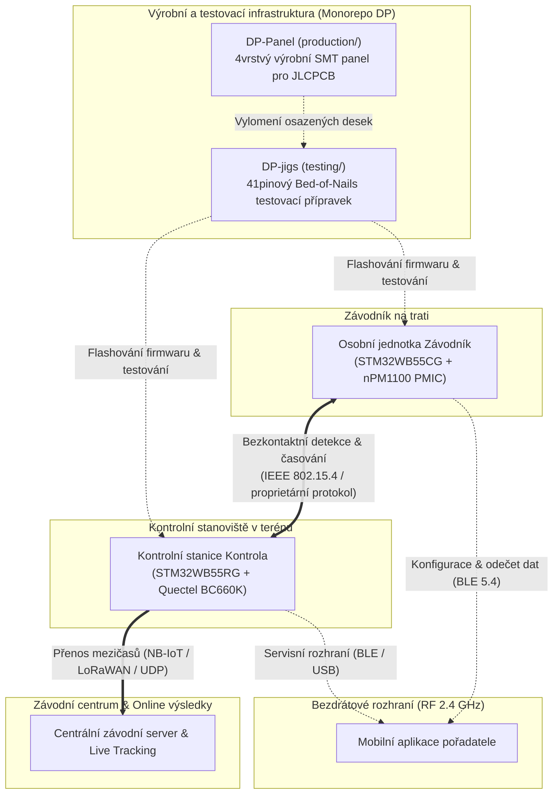

# Diplomová práce – Systém kontrolních stanovišť a osobních jednotek pro orientační sporty

> Komplexní hardwarový a softwarový ekosystém pro měření mezičasů a bezdrátový přenos dat při orientačních a vytrvalostních závodech. Systém využívá časování a vzájemnou rádiovou komunikaci dle standardu **IEEE 802.15.4**, Bluetooth Low Energy (BLE) pro konfiguraci a mobilní odečet, bezdrátové indukční nabíjení Qi a vzdálený přenos mezičasů do závodního centra přes síť **NB-IoT** (Narrowband IoT) nebo **LoRa**.

**Stav projektu:** `Aktivní / Vývoj & Výroba` | **Hlavní technologie:** `KiCad 9, C / STM32WB55 (ARM Cortex-M4/M0+), Quectel NB-IoT, IEEE 802.15.4, BLE 5.4, Qi Wireless Charging`

---

## 1. Účel a řešený problém

Tradiční systémy pro orientační běh vyžadují fyzický kontakt čipu závodníka s kontrolní stanicí (kontaktní ražení) nebo využívají proprietární rádiové protokoly s omezeným dosahem a bez možnosti přímého online přenosu průběžných mezičasů z lesa do cílového prostoru.

Tento projekt přináší moderní řešení sestávající ze dvou klíčových jednotek:
1. **Základnová kontrolní stanice (Kontrola):** Stacionární jednotka umístěná na kontrolním bodě v terénu. Detekuje průchod závodníků bezkontaktně v rádiovém poli IEEE 802.15.4, zaznamenává přesný čas průchodu s vysokou stabilitou a odesílá mezičasy přes celulární síť NB-IoT na server pořadatele.
2. **Osobní jednotka závodníka (Závodník):** Kompaktní, lehká a odolná jednotka nošená běžcem na ruce či oděvu. Při průchodu kontrolním bodem provede záznam do interní paměti a poskytne závodníkovi vizuální a akustickou zpětnou vazbu (LED, piezo bzučák).
3. **Výrobní a testovací infrastruktura:** Integrovaný technologický panel pro sériové SMT osazení (`production/`) a jehličkový programovací přípravek Bed-of-Nails (`testing/`) pro rychlé nahrání firmwaru a testování.

---

## 2. Systémová architektura



---

## 3. Struktura repozitáře

Monorepo sdružuje firmware, výrobní data plošných spojů a testovací přípravky diplomové práce:

```text
.
├── Kontrola_Syst/          # Firmware kontrolní základny v jazyce C (STM32CubeIDE, FreeRTOS, BLE/RF stack)
├── Zavodnik_Syst/          # Firmware jednotky závodníka v jazyce C (STM32CubeIDE, ultra-low-power režimy)
├── production/             # [PRJ-12] Výrobní panelizace plošných spojů (DP-Panel) pro JLCPCB SMT linku
│   ├── DP-Panel.kicad_pcb  # KiCad návrh sdruženého 4vrstvého panelu (114.05 × 77.55 mm)
│   ├── DP-Panel-job.gbrjob # Gerber job s definicí stackupu Nan-Ya NP-155FR
│   ├── DP-Panel-layout*.pdf# Výkresy vrstev a rozmístění panelu
│   ├── fab-data/           # Finální výrobní archiv DP-Fab-Data.zip, BOM.csv s LCSC ID a CPL souřadnice
│   └── README.md           # Podrobná technická dokumentace výrobního panelu
├── testing/                # [PRJ-13] Testovací a programovací přípravek Bed-of-Nails (DP-jigs)
│   ├── DP-jigs.kicad_pcb   # KiCad návrh 2vrstvé desky testovacího přípravku
│   ├── DP-jigs.kicad_sch   # Schéma propojení 41 pružinových hrotů na konektor IDC 2×22
│   ├── DP-jigs-layout*.pdf # Montážní a osazovací výkresy zkušebních jehel
│   ├── fab-data/           # Výrobní data přípravku DP-jigs.zip, BOM a CPL
│   └── README.md           # Podrobná dokumentace přípravku a postup oživování
├── .gitignore              # Ochrana před commitem build artefaktů, záloh a mezipamětí
└── README.md               # Tato hlavní přehledová dokumentace monorepa
```

---

## 4. Výrobní panelizace (`production/`)

Modul `production/` obsahuje podklady pro sdruženou výrobu obou jednotek v jednom technologickém panelu:
- **Rozměry:** 114.05 × 77.55 mm, 4 vrstvy, tloušťka 1.6 mm (Nan-Ya NP-155FR core).
- **Technologické prvky:** Optické značky (Fiducial marks), 3mm technologické unášecí otvory, perforované můstky (Mouse bites) pro bezpečné vylomení.
- **SMT komponenty:** Sdružený kusovník `DP-Fab-Data_bom.csv` obsahuje kompletní osazení pro mikrokontroléry STM32WB55, modem Quectel BC660K, přijímače bezdrátového Qi nabíjení BQ51013B, integrované PMIC nPM1100 a lineární nabíječe BQ24232.

Podrobné informace viz [production/README.md](file:///c:/Users/josef/Documents/KiCad-projects/DP/production/README.md).

---

## 5. Testovací přípravek (`testing/`)

Modul `testing/` obsahuje hardwarový tester Bed-of-Nails:
- **Rozhraní:** Dvouřadý IDC konektor 2×22 pinů (`J1`) s roztečí 2.54 mm pro připojení programátoru ST-Link (SWD), USB-UART převodníku a napájecího zdroje.
- **Zkušební jehly:** 41 odpružených kontaktů (`J4`–`J45`) propojujících testovací plošky na spodních stranách desek Kontrola i Závodník.
- **Funkce:** Oživení napájecích regulátorů (3.3 V), kontrola proudového odběru, flashování bootloaderu/firmwaru a verifikace rádiového rozhraní.

Podrobné informace viz [testing/README.md](file:///c:/Users/josef/Documents/KiCad-projects/DP/testing/README.md).

---

## 6. Firmware modulů

Firmware pro obě jednotky je vyvíjen v prostředí **STM32CubeIDE** s využitím HAL knihoven a STM32WB bezdrátového koprocesorového subsystému (M0+ jádro obsluhující BLE a 802.15.4 stack, M4 aplikační jádro):
- `Kontrola_Syst/`: Obsluhuje rádiový přijímač 802.15.4, RTC časování, komunikaci s NB-IoT modemem přes AT příkazy a ukládání logů do paměti.
- `Zavodnik_Syst/`: Obsluhuje ultra-low-power uspávání, buzení magnetem přes Hallův senzor, periodické vysílání identifikačních paketů a signalizaci.

---

## 7. Návaznost na související moduly v rámci diplomové práce

Ekosystém diplomové práce zahrnuje následující projektové části:
- **PRJ-10 (DP-Kontrola):** Zdrojový návrh desky kontrolní stanice (KiCad).
- **PRJ-11 (DP-Zavodnik):** Zdrojový návrh desky závodníka (KiCad).
- **PRJ-12 (DP-Panel):** Integrováno ve složce `production/`.
- **PRJ-13 (DP-jigs):** Integrováno ve složce `testing/`.
- **PRJ-14 (DP-Frame):** Konstrukční a mechanické rámové desky.
- **PRJ-15 (DP-Enclosure):** 3D modely krabiček ve FreeCADu pro obě jednotky.
