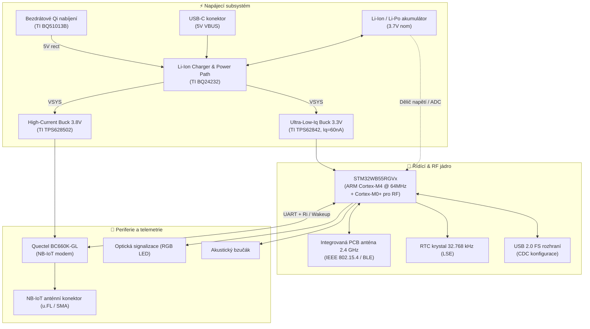
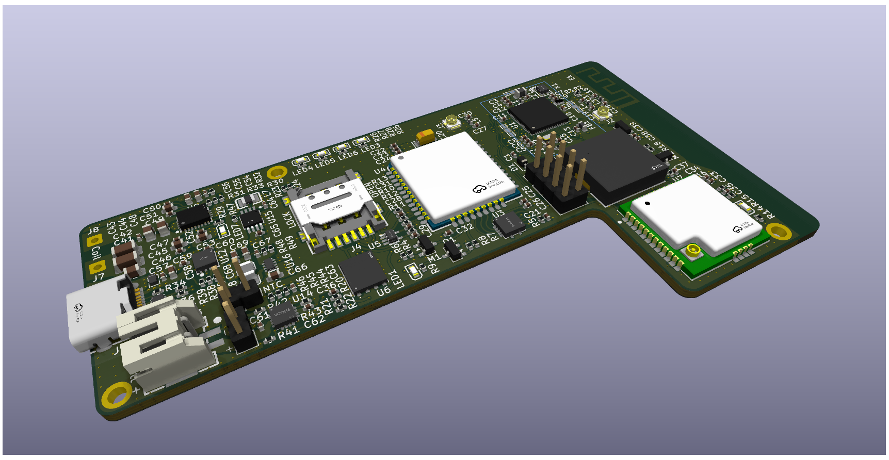
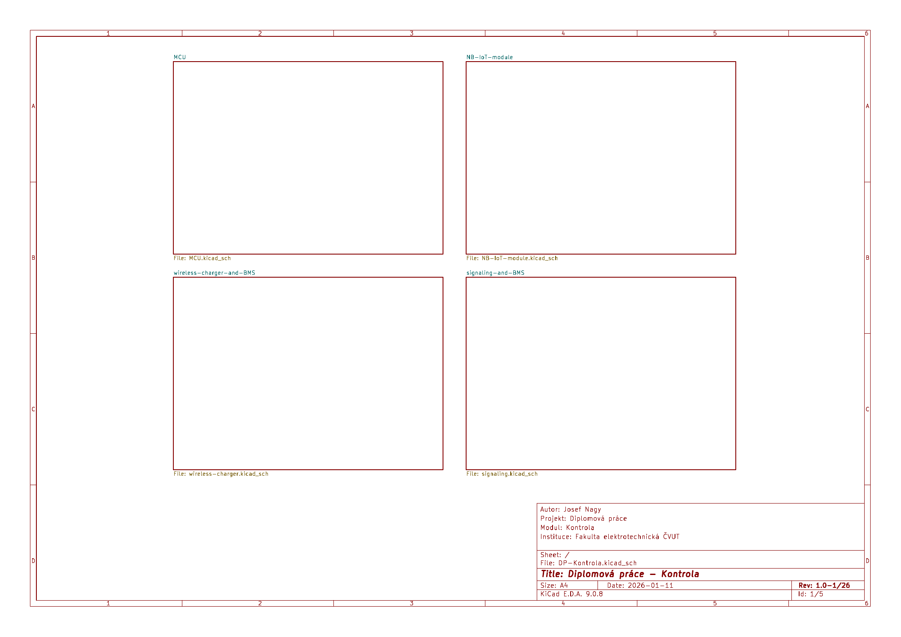
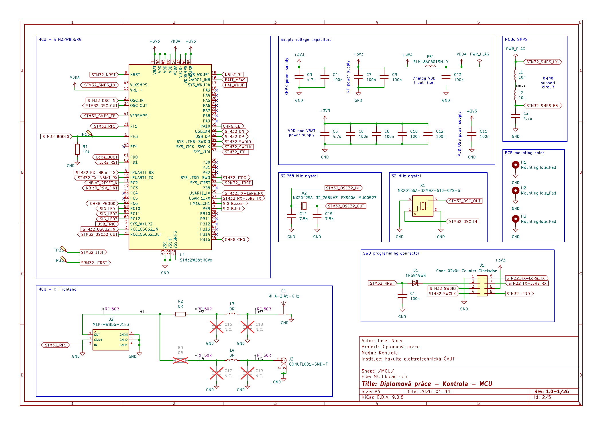
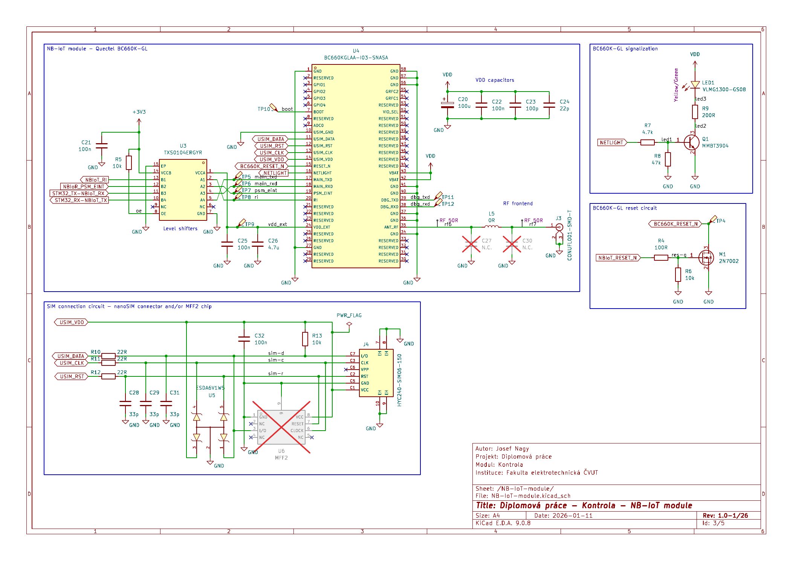
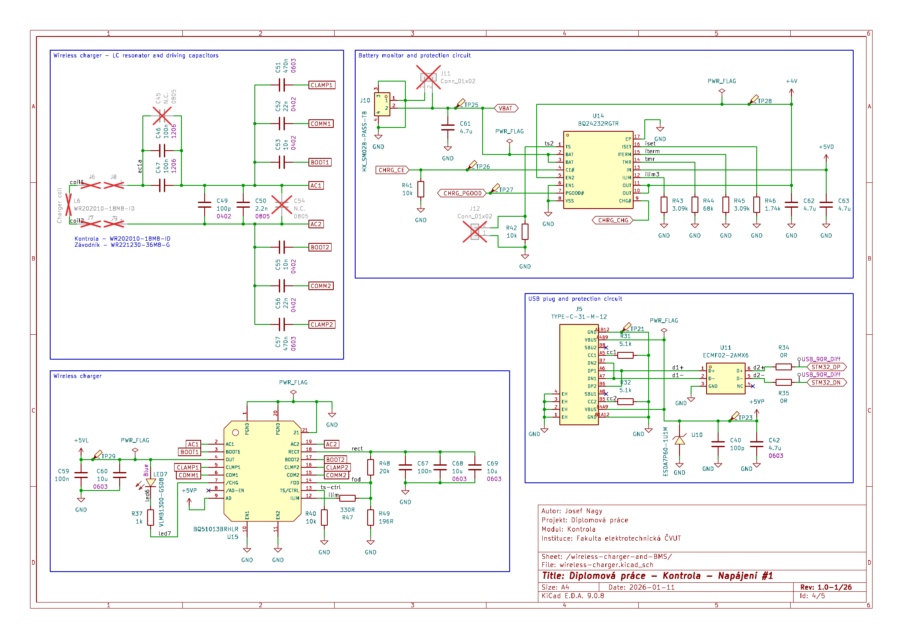
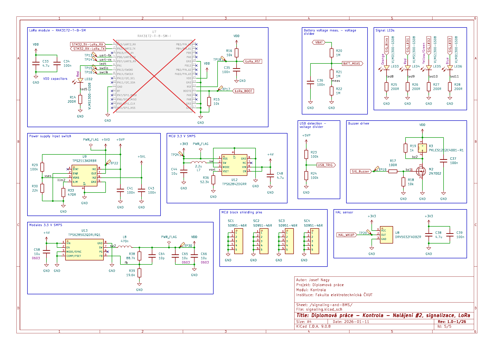
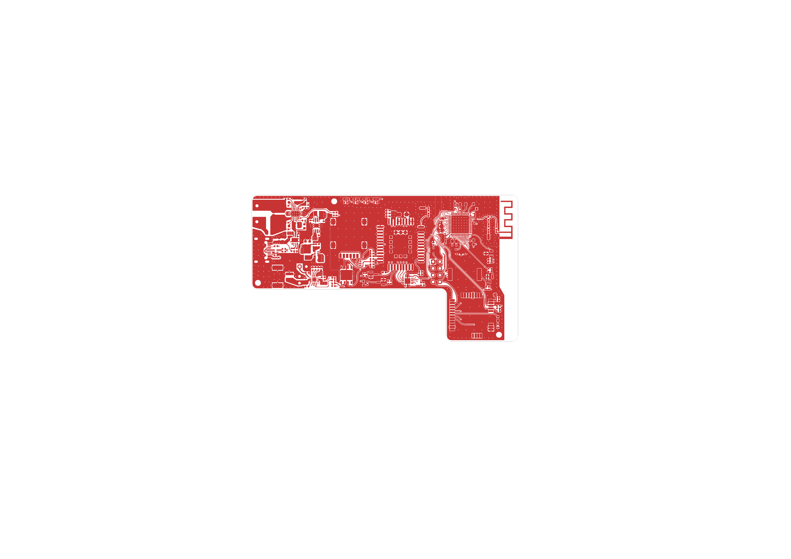

# DP-Kontrola – Hardwarová základnová jednotka časomíry

> Hardwarový návrh 4vrstvé desky plošných spojů stacionární kontrolní stanice pro bezkontaktní časomíru orientačního běhu s dvoujádrovým bezdrátovým mikrokontrolérem STM32WB55, integrovanou RF anténou 2.4 GHz, NB-IoT konektivitou pro online přenos mezičasů do centra závodu a bezdrátovým Qi nabíjením.

**Stav projektu:** Dokončeno (HW Revize 2.1) | **Hlavní technologie:** KiCad 8/9, STM32WB55RGV6 (Dual-core ARM Cortex-M4 + M0+), Quectel BC660K-GL (NB-IoT), Texas Instruments Power Management (BQ51013B, BQ24232, TPS62842)

---

## 1. Účel a funkce

Projekt **DP-Kontrola** tvoří základnovou (stacionární) stanici komplexního systému bezkontaktní časomíry pro orientační sporty (orientační běh, MTBO, běh na lyžích). Stanice je umístěna v terénu na kontrolním stanovišti (lampionu) a plní následující funkce:

- **Bezkontaktní detekce závodníka:** Využívá radiové rozhraní 2.4 GHz na protokolu IEEE 802.15.4 a Bluetooth Low Energy (BLE) pro spolehlivou registraci průběhu závodníka s osobní jednotkou [DP-Zavodnik](../DP-Zavodnik).
- **Přesné měření času:** Synchronizovaný vnitřní RTC obvod s teplotně kompenzovaným krystalem LSE zajišťuje záznam času průchodu s milisekundovou přesností.
- **Online přenos mezičasů (NB-IoT):** Integrovaný celulární modul Quectel BC660K-GL odesílá průchody závodníků v reálném čase přes úzkopásmovou síť IoT do centrálního vyhodnocovacího systému.
- **Autonomní napájení a bezdrátové nabíjení:** Možnost dobíjení Li-Ion/Li-Po článku bez nutnosti otevírání vodotěsné krabičky prostřednictvím bezdrátového Qi rozhraní (5 W) nebo USB-C konektoru s automatickým řízením napájecí cesty (Power Path).
- **Offline záznam a bezpečnost dat:** Zálohování všech oražení do interní Flash paměti pro případ výpadku mobilního signálu v hlubokém lese.

---

## 2. Architektura a blokové schéma

Deska je navržena s důrazem na minimální klidovou spotřebu energie v terénu a vysokou spolehlivost radiového přenosu.



---

## 3. Hardware, schéma a PCB

### 3.1 3D vizualizace a osazení desky


### 3.2 Schéma zapojení


<details>
<summary>🔍 Zobrazit detailní listy schématu zapojení (strany 2–5)</summary>

#### List 2: Mikrokontrolér STM32WB55, krystaly HSE/LSE a USB


#### List 3: Celulární modem Quectel BC660K-GL a SIM slot


#### List 4: Bezdrátové Qi nabíjení (BQ51013B) a nabíječ baterie (BQ24232)


#### List 5: Signalizace (RGB LED, bzučák) a monitorování napětí baterie


</details>

📄 [Otevřít kompletní schéma v plném rozlišení (vektorové PDF)](DP-Kontrola-Schema.pdf)

### 3.3 Návrh plošného spoje (PCB Layout)


📄 [Otevřít výrobní dokumentaci DPS v plném rozlišení (vektorové PDF)](DP-Kontrola.pdf)

---

## 4. Struktura projektu

```text
DP-Kontrola/
├── docs/
│   └── images/                 # Exportované grafické náhledy schémat, layoutu a 3D rendery
│       ├── pcb_3d_render.png   # 3D fotorealistický render osazené desky
│       ├── pcb_layout.png      # Náhled vrstev plošného spoje
│       └── schematic_p*.png    # Náhledy všech 5 listů schématu
├── DP-Kontrola.kicad_pro       # Hlavní projektový soubor KiCad
├── DP-Kontrola.kicad_sch       # Kořenové schéma (Sheet 1)
├── MCU.kicad_sch               # Schéma MCU části, hodin a krystalů (Sheet 2)
├── NB-IoT-module.kicad_sch     # Schéma modemu Quectel BC660K-GL a SIM slotu (Sheet 3)
├── wireless-charger.kicad_sch  # Schéma Qi cívky, BQ51013B a BQ24232 (Sheet 4)
├── signaling.kicad_sch         # Schéma LED indikace, bzučáku a monitoru baterie (Sheet 5)
├── DP-Kontrola.kicad_pcb       # 4vrstvá deska plošných spojů
├── DP-Kontrola-base.step       # 3D STEP model spodní části desky
├── DP-Kontrola-lid.step        # 3D STEP model krytu/sestavy
├── DP-Kontrola.pdf             # Kompletní výrobní dokumentace v PDF
├── DP-Kontrola-Schema.pdf      # Všechny listy schématu ve vektorovém PDF
├── DP-Kontrola-Layout-*.pdf    # Výkresy jednotlivých vrstev DPS
├── DP-Kontrola-*.dxf           # Exporty vrstev do formátu DXF pro mechanickou konstrukci
├── DP-Kontrola-*.gbr / drl     # Výrobní Gerbery a vrtací data (drill)
├── DP-Kontrola-view-*.png      # 3D fotorealistické rendery osazené desky
└── .gitignore                  # Ochrana před zálohami a cache soubory KiCadu
```

---

## 5. Technické parametry hardwaru

| Parametr | Hodnota / Specifikace |
| :--- | :--- |
| **Rozměry DPS** | Kompaktní tvar přizpůsobený skříňce [DP-Enclosure](../../mechanics) |
| **Počet vrstev** | 4 vrstvy (Top Signal, In1 Power/GND, In2 Signal, Bottom Signal) |
| **Materiál a tloušťka** | FR4, 1.6 mm, povrchová úprava ENIG (zlacení) |
| **Mikrokontrolér** | **STM32WB55RGVx** (VFQFPN68, dual-core Cortex-M4 + Cortex-M0+) |
| **RF rozhraní 2.4 GHz** | Integrovaná mikropásková anténa, LC přizpůsobovací obvod, IEEE 802.15.4 & BLE 5.4 |
| **Celulární konektivita** | **Quectel BC660K-GL** (pásma B1, B3, B5, B8, B20, B28), nanoSIM / eSIM slot |
| **Bezdrátové nabíjení** | **TI BQ51013BRHLR** – certifikovaný přijímač Qi v1.2 (až 5 W) |
| **Správa napájení a baterie** | **TI BQ24232RGTR** – lineární nabíječ Li-Ion/Li-Po s dynamickým Power-Path |
| **Napájení MCU větve** | **TI TPS62842DGRR** – ultra-low IQ synchronní step-down měnič ($I_Q \approx 60\text{ nA}$) |
| **Napájení modemu** | **TI TPS628502QDRLRQ1** – 2A synchronní step-down měnič dimenzovaný na proudové špičky NB-IoT |
| **Uživatelské rozhraní** | RGB LED stavová signalizace, piezoelektrický bzučák, servisní USB-C rozhraní |

---

## 6. Požadavky a otevření projektu

- **KiCad EDA:** Doporučena verze **8.0** nebo vyšší (projekt byl vytvořen a verifikován v KiCad 8/9).
- Pro otevření projektu otevřete soubor `DP-Kontrola.kicad_pro` v prostředí KiCad.
- Pro výrobu DPS jsou přímo v kořenové složce připraveny výrobní soubory Gerber (`DP-Kontrola-*.gbr`) a vrtací soubory Excellon (`*.drl`).
- Pro mechanickou integraci do pouzdra jsou k dispozici modely `DP-Kontrola-base.step` a `DP-Kontrola-lid.step`.

---

## 7. Vazby na další projekty

Projekt je pevnou součástí ekosystému diplomové práce:

- **[DP-Zavodnik](../DP-Zavodnik) (PRJ-11):** Párová mobilní jednotka závodníka, se kterou kontrola komunikuje protokolem 802.15.4.
- **[DP Monorepo](https://github.com/nagyjose/DP):** Centrální repozitář obsahující firmware obou jednotek (`Kontrola_Syst`, `Zavodnik_Syst`).
- **[DP-Panel](../../production) (PRJ-12):** Panelizovaná výrobní předloha sdružující desky Kontrola a Závodník do jednoho výrobního přířezu.
- **[DP-jigs](../../testing) (PRJ-13):** Jehličkový programovací a testovací přípravek (pogo-pin bed-of-nails) pro oživování této desky.
- **[DP-Enclosure](../../mechanics) (PRJ-15):** 3D model vodotěsného plastového pouzdra navržený ve FreeCADu.

---

## 8. Stav projektu a historie

- **Verze 1.0 (Bakalářský projekt):** Vývojový prototyp postavený na komerčních vývojových kitech Nucleo.
- **Verze 2.0 (Diplomový projekt):** První integrovaná deska s STM32WB55 a základním RF přenosem.
- **Verze 2.1 (Diplomová práce - Finální):** Plně osazená a odladěná revize s integrovaným NB-IoT modemem, Qi bezdrátovým nabíjením, power-pathem a optimalizovanou 4vrstvou RF částí. Výroba a funkční zkoušky proběhly úspěšně.
