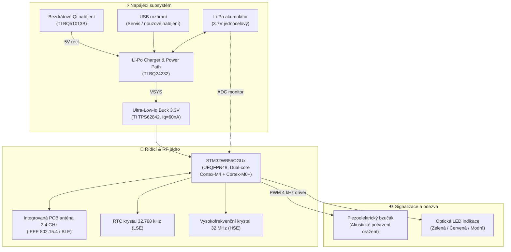

# DP-Zavodnik – Hardwarová osobní jednotka závodníka

> Hardwarový návrh kompaktní 4vrstvé desky plošných spojů osobní jednotky pro bezkontaktní časomíru orientačních sportů (nositelné zařízení na ruku, prst či řídítka kola) s mikrokontrolérem STM32WB55, integrovanou RF anténou 2.4 GHz (IEEE 802.15.4 / BLE), akusticko-optickou odezvou a bezdrátovým Qi nabíjením.

**Stav projektu:** Dokončeno (HW Revize 1.0) | **Hlavní technologie:** KiCad 8/9, STM32WB55CGUx (UFQFPN48, Dual-core ARM Cortex-M4 + M0+), Texas Instruments Power Management (BQ51013B, BQ24232, TPS62842)

---

## 1. Účel a funkce

Projekt **DP-Zavodnik** představuje osobní mobilní jednotku (obdoba moderního elektronického čipu SI-Card / SIAC) v systému bezkontaktní časomíry pro orientační sporty. Závodník jednotku nese během celého závodu upevněnou na prstu, zápěstí nebo na rámu kola (MTBO). 

Hlavní funkce zařízení:
- **Bezkontaktní ražení kontrol (Air Punching):** Automatická detekce kontrolního stanoviště [DP-Kontrola](../DP-Kontrola) při průběhu v rádiovém dosahu pomocí standardu IEEE 802.15.4 bez nutnosti fyzického zasouvání čipu do otvoru.
- **Okamžitá odezva (Feedback):** Výkonný akustický bzučák buzený signálem 4 kHz a vysoce svítivé LED diody dávají závodníkovi v plném běhu okamžité a zřetelné potvrzení úspěšného zaznamenání kontrolního bodu.
- **Nenulová paměť závodu:** Ukládání identifikačních kódů kontrol a přesných časů oražení do interní paměti mikrokontroléru pro následné vyčtení v cílovém prostoru.
- **Ergonomická nositelná konstrukce:** Zaoblený tvar desky přizpůsobený tělu závodníka a integraci do kompaktního pouzdra [DP-Enclosure](../DP-Enclosure).
- **Hermetické provedení a Qi nabíjení:** Zařízení nemá vnější kontakty podléhající oxidaci a znečištění blátem či potem; nabíjení vestavěného Li-Po článku probíhá bezdrátově přes standard Qi.

---

## 2. Architektura a blokové schéma

Schéma zapojení je optimalizováno pro minimální rozměry, nízkou hmotnost a maximální výdrž na jedno nabití.



---

## 3. Struktura projektu

```text
DP-Zavodnik/
├── DP-Zavodnik.kicad_pro       # Hlavní projektový soubor KiCad
├── DP-Zavodnik.kicad_sch       # Kořenové schéma (Sheet 1)
├── MCU.kicad_sch               # Schéma zapojení mikrokontroléru STM32WB55CGUx (Sheet 2)
├── wireless-charger.kicad_sch  # Schéma Qi bezdrátového nabíjení a Power-Path (Sheet 3)
├── signaling.kicad_sch         # Schéma driveru bzučáku, LED diod a měření baterie (Sheet 4)
├── DP-Zavodnik.kicad_pcb       # 4vrstvá deska plošných spojů s optimalizovaným tvarem
├── DP-Zavodnik-Base.step       # 3D STEP model spodní části desky
├── DP-Zavodnik-Lid.step        # 3D STEP model krytu/sestavy
├── DP-Zavodnik-Layout.pdf      # Výrobní výkres vrstev DPS v PDF
├── DP-Zavodnik-Schema.pdf      # Vektorové schéma v PDF
├── DP-Zavodnik-*.dxf           # Exporty vrstev do formátu DXF pro mechanickou konstrukci
├── DP-Zavodnik-view-*.png      # Fotorealistické 3D rendery osazené desky
└── .gitignore                  # Ochrana před zálohami, kolizními soubory a cache KiCadu
```

---

## 4. Technické parametry hardwaru

| Parametr | Hodnota / Specifikace |
| :--- | :--- |
| **Rozměry a tvar** | Miniaturní zaoblená deska optimalizovaná pro tělo sportovce |
| **Počet vrstev** | 4 vrstvy (Top Signal, In1 Power/GND, In2 Signal, Bottom Signal) |
| **Materiál a tloušťka** | FR4, 1.6 mm, povrchová úprava ENIG (zlacení) |
| **Mikrokontrolér** | **STM32WB55CGUx** (UFQFPN48, dual-core Cortex-M4 @ 64 MHz + Cortex-M0+ pro RF) |
| **RF rozhraní 2.4 GHz** | Integrovaná mikropásková anténa, LC filtr, IEEE 802.15.4 & BLE 5.4 |
| **Bezdrátové nabíjení** | **TI BQ51013BRHLR** – certifikovaný přijímač Qi standardu |
| **Správa napájení a nabíjení** | **TI BQ24232RGTR** – lineární nabíječ s dynamickým řízením napájení |
| **Step-down napájení** | **TI TPS62842DGRR** – ultra-low IQ měnič pro maximalizaci výdrže akumulátoru |
| **Akustická odezva** | Piezo měnič řízený diskrétním MOSFET budičem na rezonanční frekvenci 4 kHz |
| **Optická odezva** | Vysoce svítivé signalizační LED diody |
| **Napájení** | Integrovaný miniaturní Li-Po článek (3.7 V) |

---

## 5. Požadavky a otevření projektu

- **KiCad EDA:** Doporučena verze **8.0** nebo novější (projekt vytvořen a verifikován v KiCad 8/9).
- Pro otevření projektu spusťte `DP-Zavodnik.kicad_pro` v KiCadu.
- Výrobní předlohy jednotlivých vrstev jsou k dispozici v souborech `DP-Zavodnik-Layout.pdf` a DXF exportech.
- Pro návrh plastové krabičky a montážních prvků použijte 3D STEP modely `DP-Zavodnik-Base.step` a `DP-Zavodnik-Lid.step`.

---

## 6. Vazby na další projekty

- **[DP-Kontrola](../DP-Kontrola) (PRJ-10):** Základnová stacionární stanice, která zaznamenává průchod této jednotky.
- **[DP Monorepo](https://github.com/nagyjose/DP):** Centrální repozitář obsahující firmware `Zavodnik_Syst` a `Kontrola_Syst`.
- **[DP-Panel](../DP-Panel) (PRJ-12):** Společná panelizace s deskou Kontrola pro hromadné osazování.
- **[DP-jigs](../DP-jigs) (PRJ-13):** Testovací a flashovací přípravek pro nahrání firmwaru na výrobní lince.
- **[DP-Enclosure](../DP-Enclosure) (PRJ-15):** 3D model pouzdra navržený ve FreeCADu.

---

## 7. Stav projektu a historie

- **Verze 1.0 (Diplomová práce - Finální):** Kompletně navržený hardware, vyrobené prototypové desky, ověřena funkčnost bezdrátového nabíjení, 4 kHz bzučáku i oboustranné rádiové komunikace 802.15.4 s jednotkou Kontrola.
