# DP-Enclosure – Mechanická pouzdra a krabičky časoměrného systému (DP)

> 3D mechanická konstrukce ochranných pouzder a krabiček pro základnovou stanici **Kontrola** a osobní jednotku **Závodník** vyvinutá v rámci diplomové práce bezdrátového časoměrného systému pro orientační sporty.

**Stav projektu:** Dokončeno (podklady pro 3D tisk a vizualizace) | **Hlavní technologie:** FreeCAD (`.FCStd`), 3D CAD modelování, FDM/SLA 3D tisk, CAD rendering

---

## 1. Účel a funkce

Projekt `DP-Enclosure` obsahuje kompletní mechanické řešení pouzder pro obě hardwarové jednotky časoměrného systému:

1. **Základnová stanice (Kontrola):**
   - Robustní stacionární pouzdro pro kontrolní body v terénu.
   - Uložení 4vrstvé desky `DP-Kontrola`, Li-Ion akumulátoru s vysokou kapacitou, cívky pro bezdrátové nabíjení a anténních modulů (IEEE 802.15.4 / BLE, NB-IoT a LoRa).
   - Konstrukce s těsnicí drážkou pro ochranu proti stříkající vodě a prachu (outdoorové použití v lese za nepříznivého počasí).
   - Mechanické montážní body pro upevnění na stojan lampionu orientačního běhu nebo strom.

2. **Osobní jednotka (Závodník):**
   - Vysoce kompaktní, ergonomické nositelné pouzdro (na ruku, prst nebo dres závodníka).
   - Minimalizace hmotnosti a aerodynamický zaoblený profil eliminující riziko zachycení o větve v terénu.
   - Uložení desky `DP-Zavodnik`, přijímací antény, optické signalizace (LED indikace zaznamenání kontroly) a ploché Li-Pol baterie.

---

## 2. Architektura a mechanická skladba

Mechanické uspořádání jednotek je navrženo s ohledem na snadnou montáž, servisovatelnost a spolehlivost v polních podmínkách.

```mermaid
flowchart TD
    subgraph Kontrola["Základnová jednotka Kontrola"]
        K_Top["Horní kryt (s průzorem pro LED a anténní okno)"]
        K_Seal["Těsnění / Obvodová drážka"]
        K_PCB["DPS DP-Kontrola (upevnění šrouby na distanční sloupky)"]
        K_Batt["Akumulátor 18650 / Li-Pol"]
        K_Coil["Cívka bezdrátového Qi nabíjení"]
        K_Bottom["Spodní šasi s montážními úchyty pro terénní stojan"]
        
        K_Top --- K_Seal
        K_Seal --- K_PCB
        K_PCB --- K_Batt
        K_Batt --- K_Coil
        K_Coil --- K_Bottom
    end

    subgraph Zavodnik["Osobní jednotka Závodník"]
        Z_Top["Horní ergonomické víko s optickým rozptylovačem"]
        Z_PCB["DPS DP-Zavodnik s integrovanou anténou"]
        Z_Batt["Ultralehký Li-Pol článek"]
        Z_Bottom["Spodní skořepina s průvlaky na sportovní pásek"]
        
        Z_Top --- Z_PCB
        Z_PCB --- Z_Batt
        Z_Batt --- Z_Bottom
    end
```

---

## 3. Vizuální náhledy a 3D rendery pouzder

### 3.1 Základnová stanice Kontrola

Robustní outdoorové pouzdro navržené pro montáž na orientační stojan či strom v lesním terénu s důrazem na vodotěsnost a mechanickou odolnost.

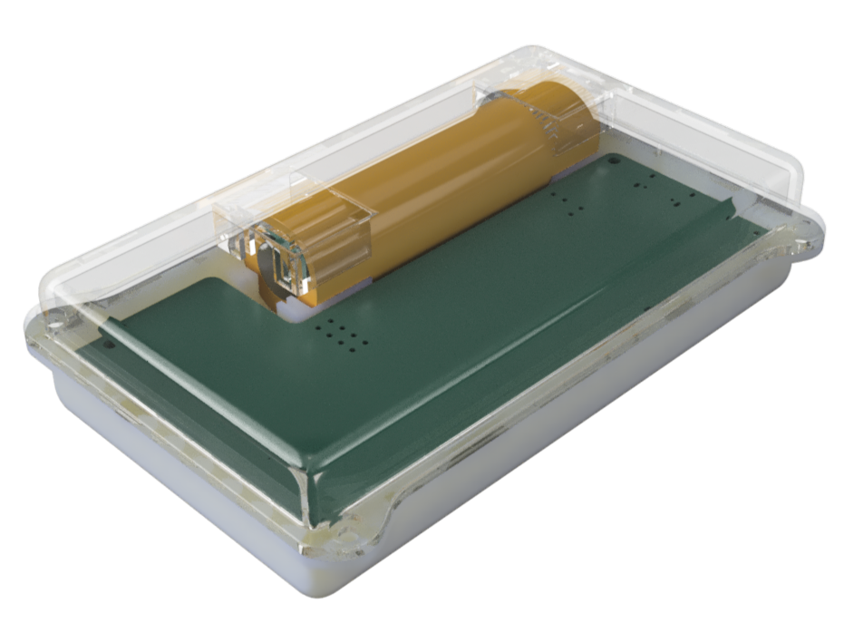
*Obrázek 1: Celkový izometrický pohled na sestavené pouzdro kontrolní stanice Kontrola.*

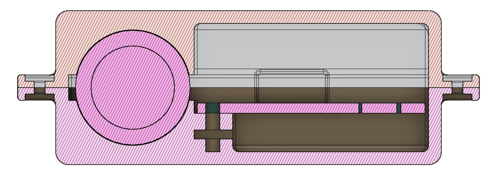
*Obrázek 2: Řez pouzdrem s vnitřním uspořádáním elektroniky, akumulátoru a těsnicí spáry.*

<details>
<summary>🔍 Zobrazit všech 7 detailních konstrukčních pohledů jednotky Kontrola</summary>

| Pohled shora | Pohled z boku |
| :---: | :---: |
| 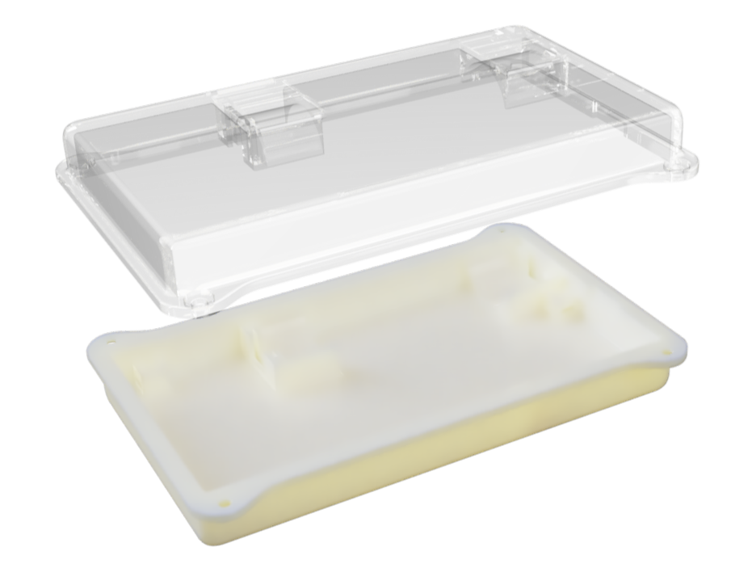 | 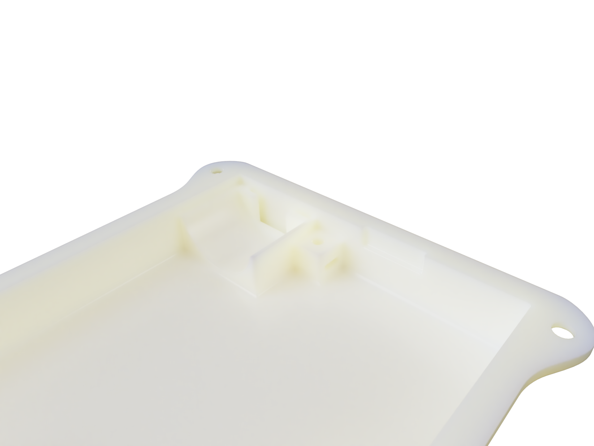 |

| Vnitřní šasi pro PCB a baterii | Lůžko bezdrátového Qi nabíjení |
| :---: | :---: |
| 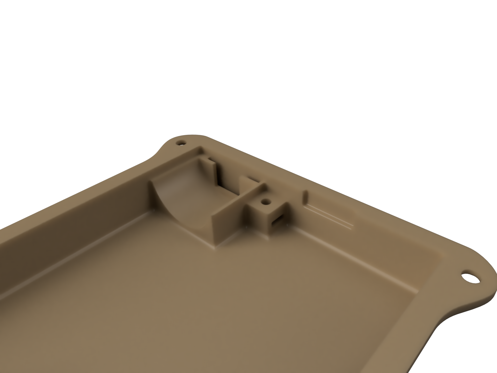 | 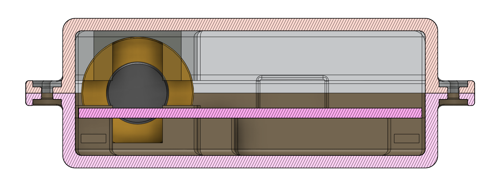 |

| Obvodové prolisy těsnění | Distanční vodicí sloupky pro šrouby |
| :---: | :---: |
| 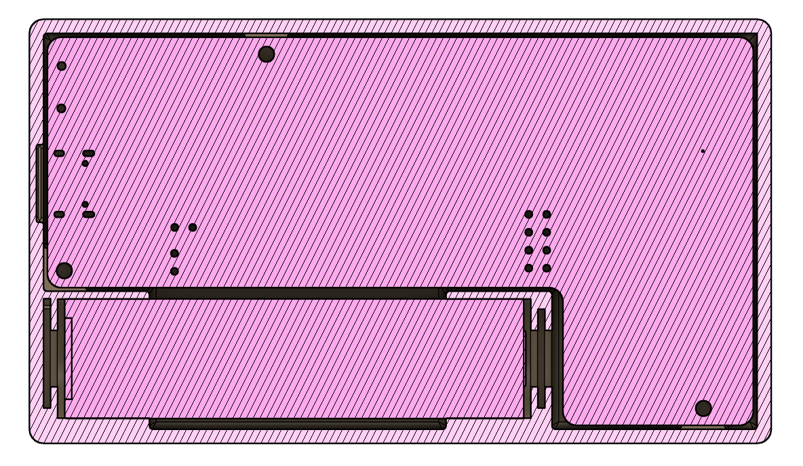 | 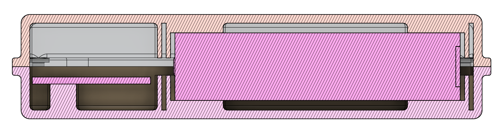 |

#### Rentgenový náhled vnitřního uspořádání
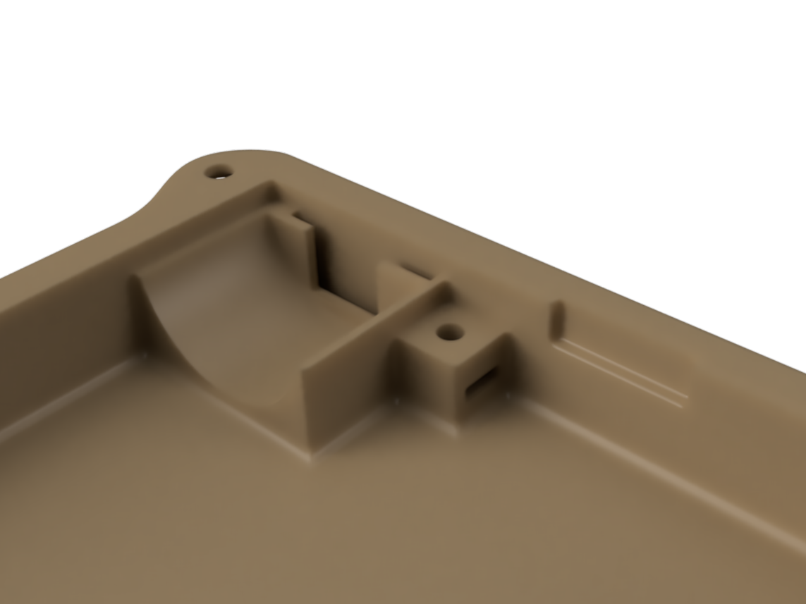
*Obrázek 2a: Transparentní rentgenový pohled na rozmístění desky a periferních antén uvnitř pouzdra.*

</details>

---

### 3.2 Osobní jednotka Závodník

Kompaktní nositelné pouzdro optimalizované pro upevnění na zápěstí, prst nebo sportovní oděv s hladkými přechody eliminujícími zachycení v podrostu.

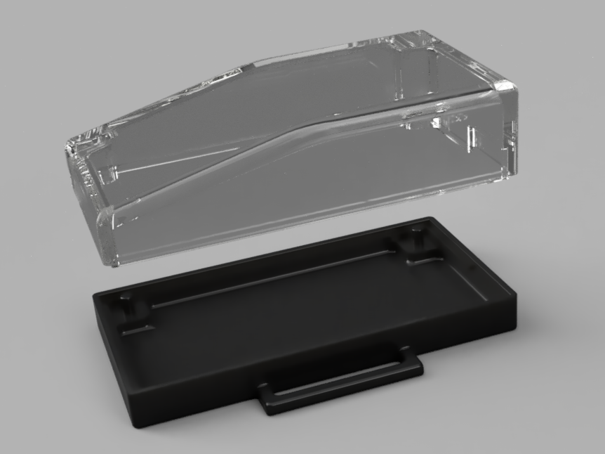
*Obrázek 3: Izometrický pohled na aerodynamické ergonomické pouzdro závodníka.*

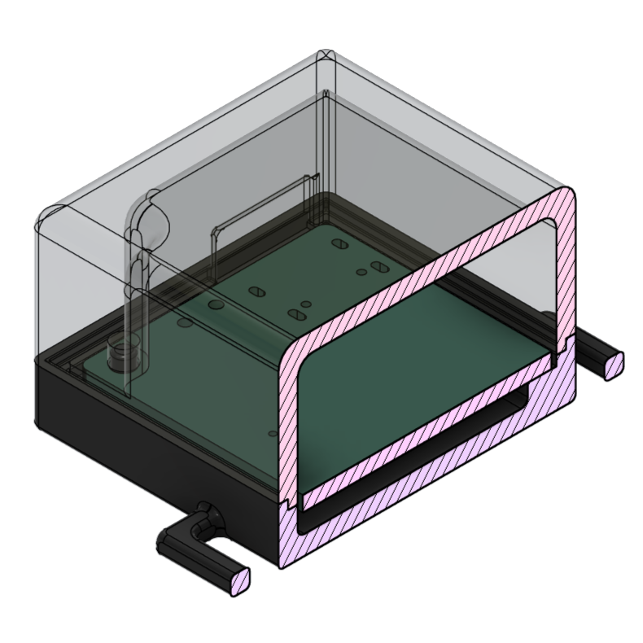
*Obrázek 4: Čelní pohled s průzorem pro LED indikátor potvrzení záznamu kontroly.*

<details>
<summary>🔍 Zobrazit všechny doplňkové pohledy jednotky Závodník (4 další pohledy)</summary>

| Spodní strana (průvlaky pro pásek) | Dělící spára a zámky skořepiny |
| :---: | :---: |
| 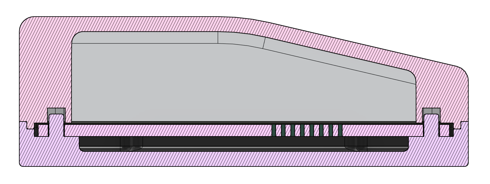 | 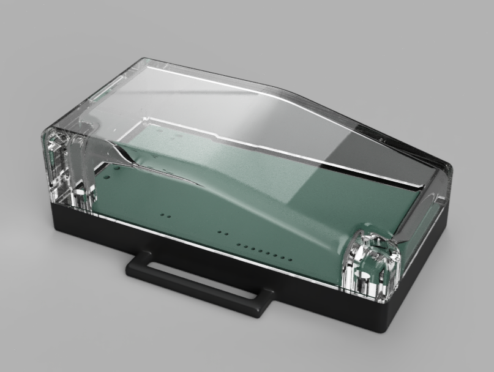 |

| Porovnání proporcí a uložení PCB | Vývojová revize v28 |
| :---: | :---: |
| 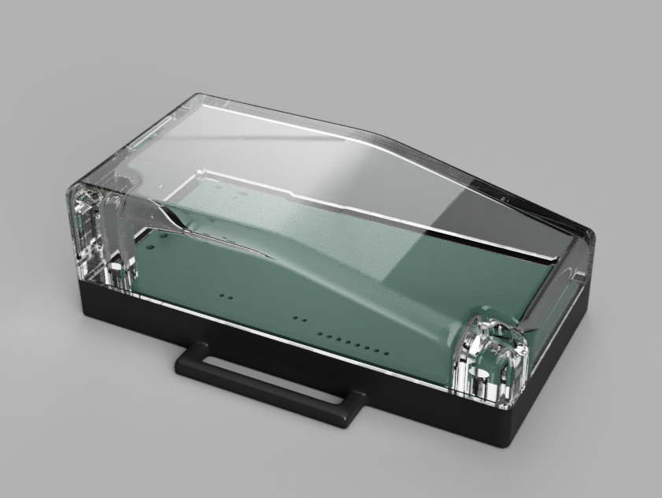 | 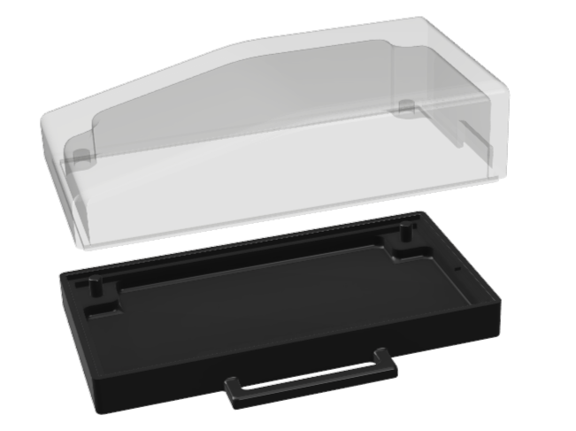 |

</details>

---

## 4. Struktura projektu a přehled souborů

```text
.
├── .gitignore                          # Ignorování záložních souborů FreeCADu (*.FCStd1) a OS balastu
├── README.md                           # Tato dokumentace
├── DP-Kontrola.FCStd                   # Hlavní parametrický 3D model krabičky Kontrola ve FreeCADu
│
├── docs/images/                        # Optimalizované vizuální náhledy pro dokumentaci
│   ├── kontrola_enclosure_*.png        # Rendery pouzdra kontrolní stanice
│   └── zavodnik_enclosure_*.png        # Rendery nositelného pouzdra závodníka
│
├── Rendery jednotky Kontrola:
│   ├── DP-Kontrola-Enclosure-view-1.png # Celkový izometrický pohled na sestavu
│   ├── DP-Kontrola-Enclosure-view-2.PNG # Pohled shora
│   ├── DP-Kontrola-Enclosure-view-3.PNG # Pohled z boku s detailem dělící roviny
│   ├── DP-Kontrola-Enclosure-view-4.PNG # Vnitřní prostor spodní skořepiny pro akumulátor a PCB
│   ├── DP-Kontrola-Enclosure-view-5.png # Detail uložení cívky bezdrátového nabíjení
│   ├── DP-Kontrola-Enclosure-view-6.png # Detail prolisů pro těsnění
│   ├── DP-Kontrola-Enclosure-view-7.png # Řez pouzdrem s osazenou deskou
│   ├── DP-Kontrola-Enclosure-view-8.png # Detail vodicích sloupků pro šrouby M2.5/M3
│   └── DP-Kontrola-Enclosure-view-9.PNG # Průhledový rentgenový model vnitřního uspořádání
│
└── Rendery jednotky Závodník:
    ├── DP-Zavodnik-Enclosure v28.png    # Revize v28 nositelného pouzdra
    ├── DP-Zavodnik-Enclosure-view-3.png # Izometrický pohled na ergonomické zakřivení
    ├── DP-Zavodnik-Enclosure-view-4.png # Pohled zespodu (průvlaky pro elastický pásek)
    ├── DP-Zavodnik-Enclosure-view-5.png # Pohled zepředu s optickým indikátorem
    ├── DP-Závodník-Enclosure-view-1.PNG # Detail dělící spáry a zámků
    └── DP-Závodník-Enclosure-view-2.PNG # Porovnání proporcí a uložení desky
```

---

## 5. Doporučené parametry pro 3D tisk a výrobu

Pro výrobu funkčních prototypů metodou aditivní výroby (3D tisk) se doporučují následující parametry:

| Parametr | Jednotka Kontrola (FDM) | Jednotka Závodník (SLA / SLS / Jemné FDM) |
| :--- | :--- | :--- |
| **Doporučený materiál** | PETG / ASA / ABS (odolnost vůči UV záření, vlhkosti a nárazům) | Tough Resin / PA12 (Nylon) / PETG |
| **Výška vrstvy** | 0.15 – 0.20 mm | 0.05 mm (SLA) nebo 0.10 – 0.12 mm (FDM) |
| **Počet perimetrů (stěn)** | min. 4 perimetry (pro zajištění vodotěsnosti stěn) | min. 3–4 perimetry / plný odlitek |
| **Výplň (Infill)** | 25–40 % (Gyroid nebo Grid pro pevnost ve všech osách) | 40–100 % (důraz na nízkou hmotnost a tuhost) |
| **Podpory (Supports)** | Pouze pro zapuštěná lůžka matic a montážní výstupky | Podle orientace na tiskové podložce |
| **Těsnění dělící spáry** | Silikonový O-kroužek nebo tekutý silikonový tmel do drážky | Lisované pryžové těsnění |

---

## 6. Práce s CAD modelem

Model `DP-Kontrola.FCStd` je vytvořen v open-source CAD systému **FreeCAD** (doporučená verze 0.20+ nebo 1.0) s využitím standardního PartDesign workbench.

1. Spusťte FreeCAD a otevřete `DP-Kontrola.FCStd`.
2. Pro export do formátu pro slicer vyberte tělo součásti (`Body`) a zvolte:
   - `Soubor -> Exportovat... -> STL mesh (*.stl)` nebo `STEP with colors (*.step)`.
3. Jednotlivé rozměry (např. tolerance pro tiskárnu) lze upravit ve stromové struktuře prvků (Pad, Pocket, Chamfer).

---

## 7. Vazby na ostatní části diplomové práce

Projekt je nedílnou mechanickou součástí komplexního ekosystému diplomové práce:

- **Hardware Kontrola (`DP-Kontrola`):** Rozměry a montážní otvory pouzdra přesně odpovídají 4vrstvé desce `DP-Kontrola.kicad_pcb` a 3D modelu `DP-Kontrola-base.step`.
- **Hardware Závodník (`DP-Zavodnik`):** Pouzdro Závodník vychází z rozměrů desky `DP-Zavodnik.kicad_pcb` a `DP-Zavodnik-Base.step`.
- **Výrobní panel (`DP-Panel`):** Obě desky jsou optimalizovány pro současné osazení v panelu.
- **Monorepo `DP`:** V rámci cílové architektury repozitáře diplomové práce tvoří tato složka subsystém `mechanics/`.

---

## 8. Stav projektu a další kroky

- [x] Dokončen parametrický 3D CAD model pouzdra stanice Kontrola (`DP-Kontrola.FCStd`).
- [x] Vygenerována a zvalidována sada 15 renderů pro vizuální kontrolu proporcí a ergonomie.
- [ ] Export samostatných STL souborů pro přímý tisk bez nutnosti otevírat FreeCAD.
- [ ] Doplnění parametrického modelu pro pouzdro jednotky Závodník v nativním formátu FreeCAD (aktuálně dostupné ve formě vyexportovaných vizualizací a STEP v `DP-Zavodnik`).
- [ ] Integrace do hlavní složky `mechanics/` monorepa `DP`.
