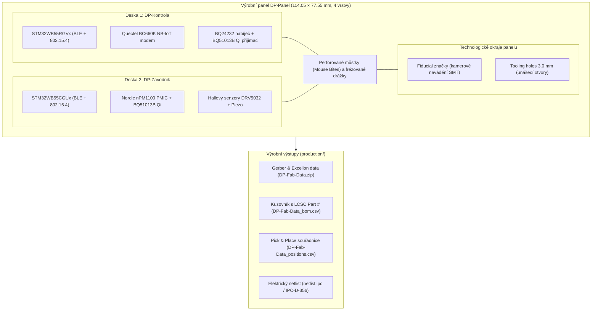
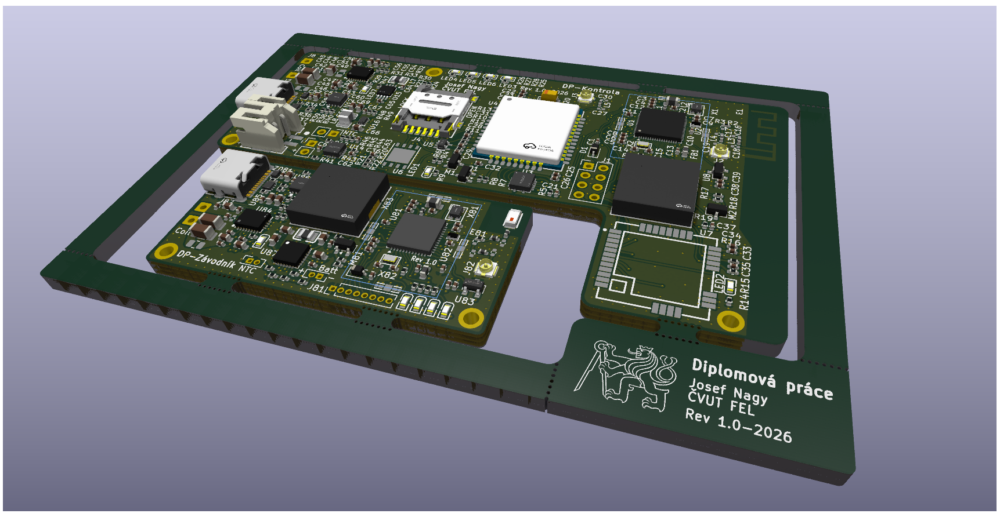
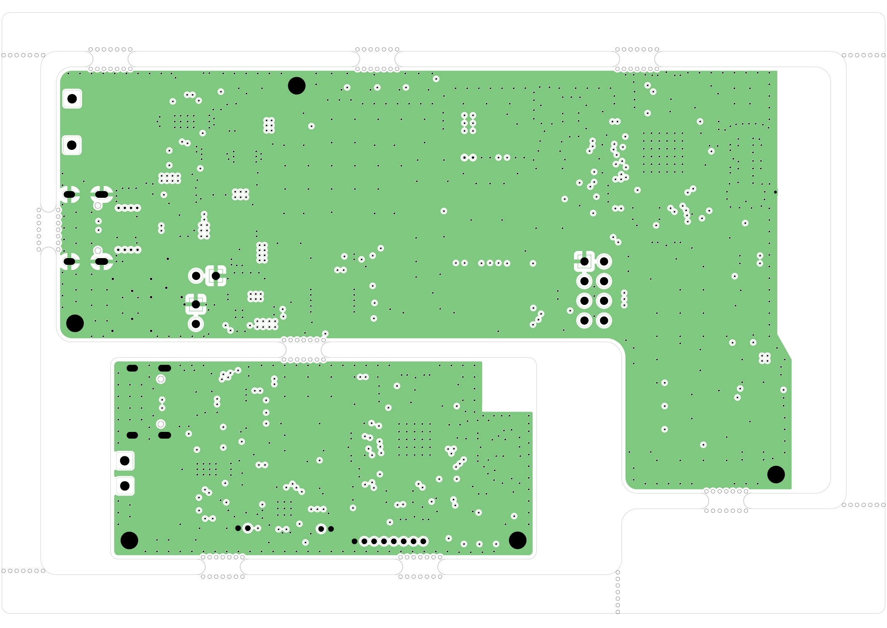
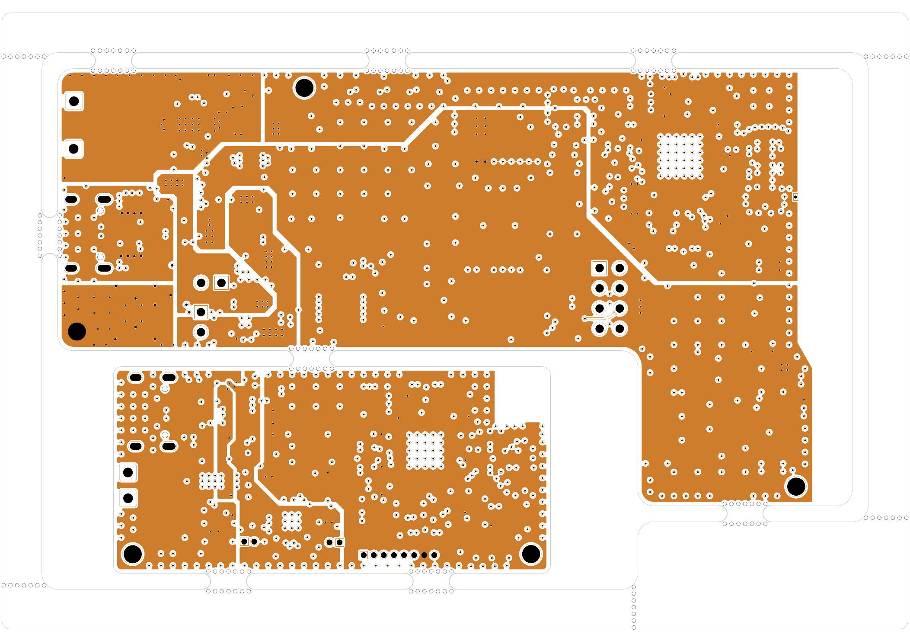
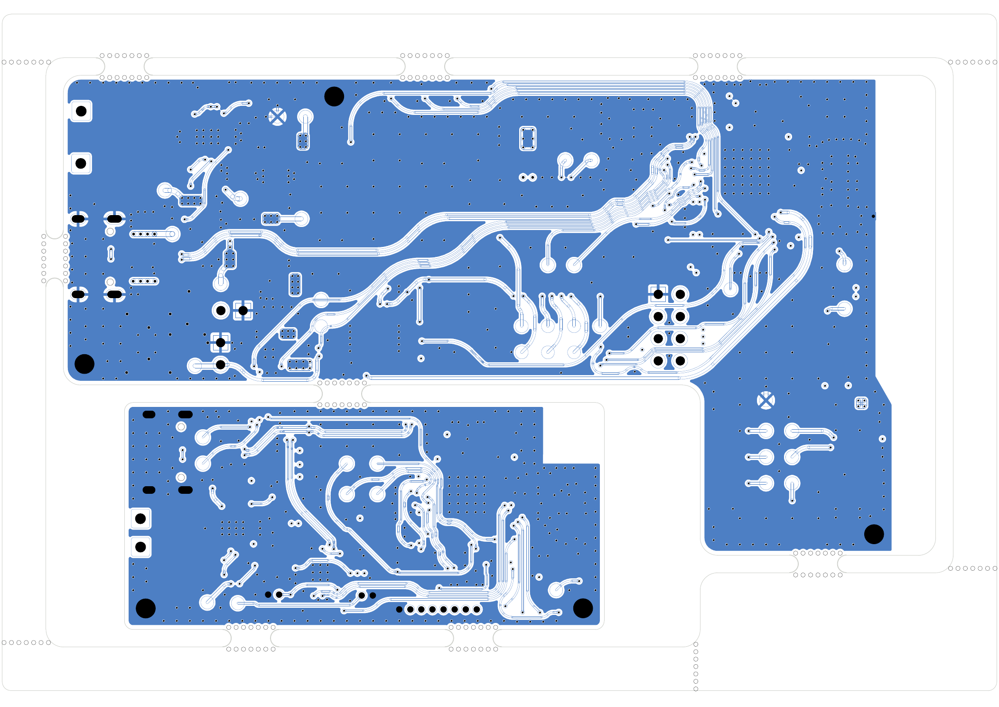
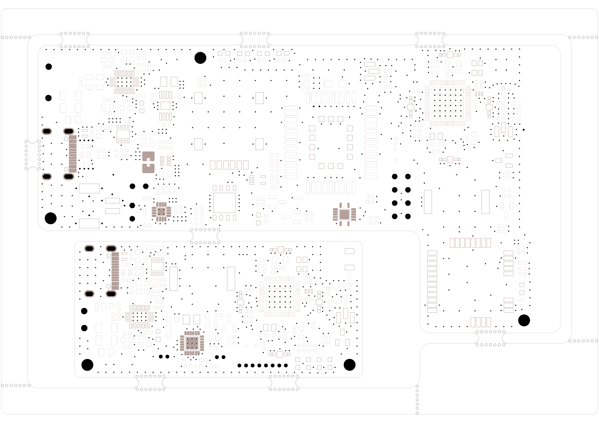
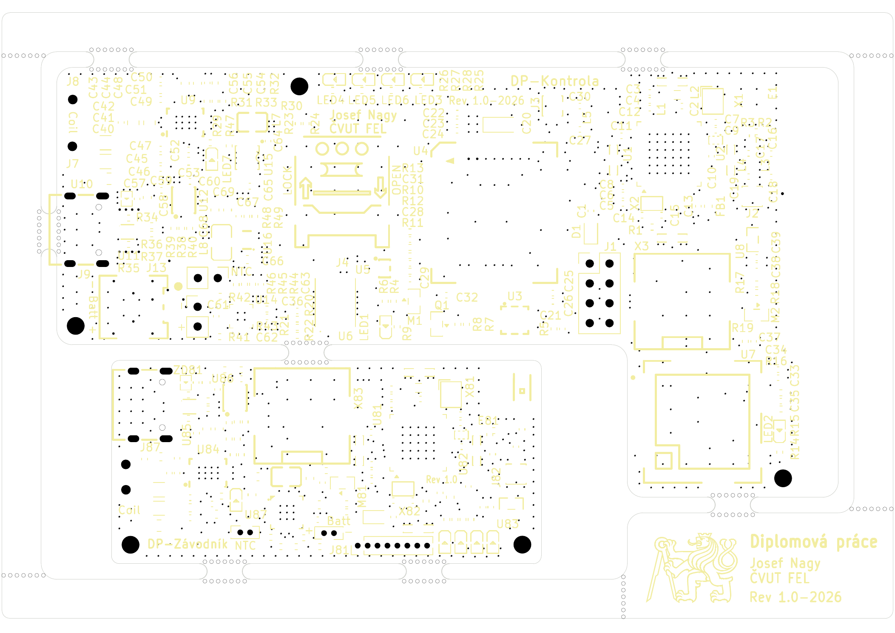
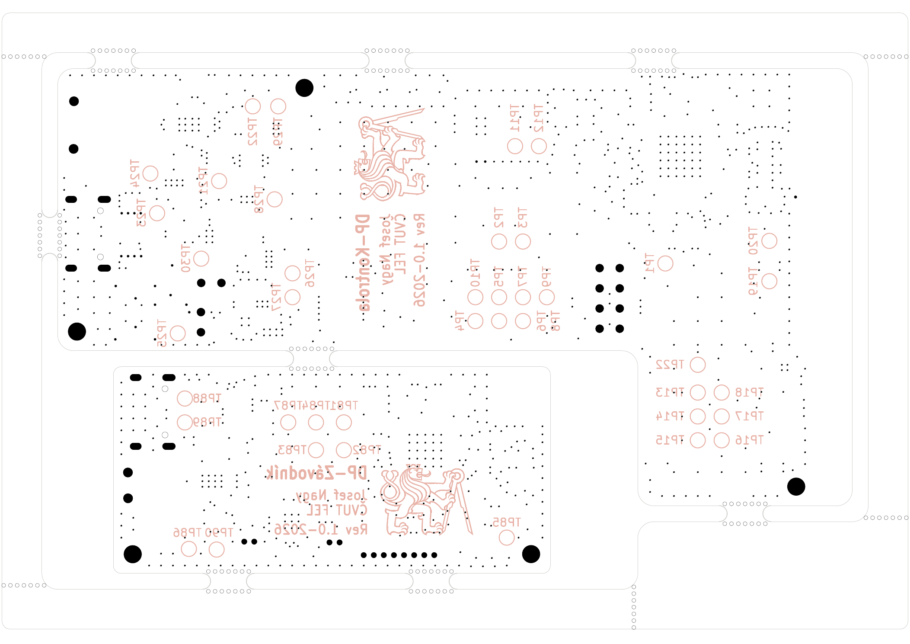
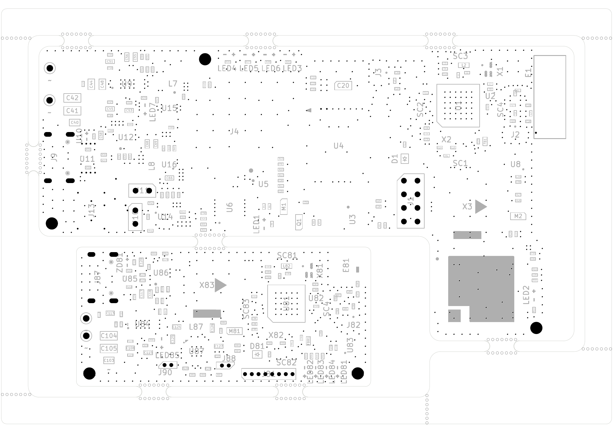
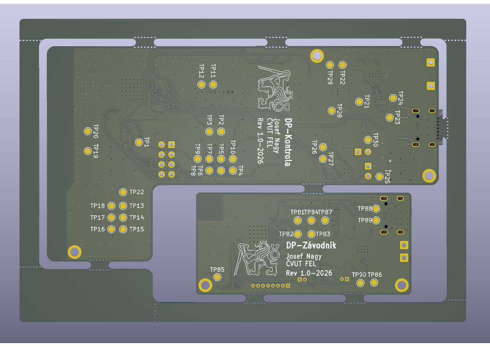

# DP-Panel – Výrobní technologický panel pro SMT osazování

> Technologická panelizace plošných spojů pro diplomovou práci, sdružující základnovou časoměrnou jednotku **Kontrola** a osobní jednotku **Závodník** do jednoho výrobního panelu pro automatizované osazování (SMT).

**Stav projektu:** `Dokončeno / Připraveno pro výrobu` | **Hlavní technologie:** `KiCad 9, JLCPCB 4-Layer SMT, Gerber, IPC-D-356`

---

## 1. Účel a funkce

Projekt `DP-Panel` řeší sdružení dvou samostatných elektronických modulů diplomové práce do jednoho výrobního rámce (panelu):
- **Jednotka Kontrola (PRJ-10):** Stacionární/kontrolní časoměrná základna s mikrokontrolérem STM32WB55RG, NB-IoT modemem Quectel BC660K, BLE/802.15.4 komunikací, napájením Li-Ion (BQ24232) a bezdrátovým Qi nabíjením (BQ51013B).
- **Jednotka Závodník (PRJ-11):** Přenosná kompaktní jednotka závodníka s mikrokontrolérem STM32WB55CG, integrovaným PMIC Nordic nPM1100, Hallovými senzory a bezdrátovým Qi nabíjením.

### Klíčové vlastnosti panelu
- **Snížení výrobních nákladů:** Výroba a osazení obou zařízení probíhá v jedné výrobní dávce na jednom panelu.
- **Automatizované osazování (SMT):** Panel je vybaven optickými zaměřovacími značkami (Fiducial marks) a montážními otvory (Tooling holes) v technologickém rámu pro přesné navedení osazovacích automatů.
- **Snadné oddělení desek:** Jednotlivé desky jsou v panelu uchyceny pomocí frézovaných drážek a perforovaných můstků (Mouse bites / Breakaway tabs), což umožňuje čisté mechanické vylomení po přetavení.
- **Kompletní výrobní balík:** Součástí jsou připravená data pro linky JLCPCB – Gerber soubory, vrtací data, sdružený kusovník (BOM) s kódy LCSC a souřadnice osazování (CPL / Centroid).

---

## 2. Architektura a výrobní proces



---

## 3. Výrobní vizualizace, layout a vrstvy PCB

### Hlavní výrobní náhledy panelu



*Obr. 1: 3D render hotového výrobního panelu sdružujícího desky Kontrola (vlevo) a Závodník (vpravo).*



*Obr. 2: Výrobní výkres horní signálové vrstvy (Top Copper F.Cu) s technologickými okraji a fiducial značkami.*

📄 [Otevřít kompletní 7stránkový výkres vrstev v plném rozlišení (PDF)](DP-Panel-layout.pdf)

<details>
<summary>🔍 Zobrazit zbývající vrstvy layoutu a 3D pohledy (In1, In2, Bottom Cu, potisky, vrtací plán)</summary>

#### Vnitřní napájecí vrstva (In1.Cu – Power / Ground plane)


#### Vnitřní signálová vrstva (In2.Cu – Internal Signals)


#### Spodní signálová vrstva (B.Cu – Bottom Copper s testovacími body)


#### Horní nepájivá maska a potisk (F.SilkS & F.Mask)


#### Spodní nepájivá maska a potisk (B.SilkS & B.Mask)


#### Vrtací plán a obrysy desek (Edge.Cuts & Drill map)


#### 3D render spodní strany panelu (testovací plošky a fiducials)


</details>

---

## 4. Technické parametry a skladba vrstev

Panel je navržen pro standardní 4vrstvý proces výrobce JLCPCB (stackup JLC04161H-7628):

| Parametr | Hodnota |
| :--- | :--- |
| **Vnější rozměry panelu** | 114.05 × 77.55 mm |
| **Celková tloušťka desky** | 1.6062 mm |
| **Počet vrstev** | 4 (Top Cu, In1 Power, In2 Signal, Bottom Cu) |
| **Základní materiál** | FR4 Nan-Ya NP-155FR, dielektrikum 7628 (RC 49 %) |
| **Tloušťka mědi** | 35 µm (1 oz) vnější i vnitřní vrstvy |
| **Povrchová úprava** | HASL olovnatý / bezolovnatý (příp. ENIG pro RF aplikace) |
| **Nepájivá maska / potisk** | Zelená / bílá |
| **Minimální šířka spoje / izolační mezera** | 0.15 mm / 0.20 mm |

### Skladba vrstev (Stackup)
1. **F.Cu (Top):** Signálová vrstva, RF vedení s impedančním přizpůsobením 50 Ω, diskrétní SMD komponenty.
2. **In1.Cu (Inner 1):** Spojitá napájecí a zemní plocha (GND/PWR plane).
3. **In2.Cu (Inner 2):** Vnitřní signálová vrstva pro propojovací sběrnice a pomocné napájení.
4. **B.Cu (Bottom):** Spodní signálová a stínící vrstva, testovací plošky (Test Points) pro testovací přípravek.

---

## 5. Struktura adresáře

```text
.
├── DP-Panel.kicad_pcb                # Návrh panelu v KiCad 9 (rozmístění desek, můstky, fiducials)
├── DP-Panel.kicad_pro                # Konfigurace projektu KiCad
├── DP-Panel.kicad_sch                # Zástupné schéma projektu
├── DP-Panel-job.gbrjob               # Strojový popis vrstev a výrobních specifikací (Gerber job)
├── DP-Panel-layout.pdf               # Kompletní výrobní výkres panelu
├── DP-Panel-layout-1..7.pdf          # Výkresy jednotlivých vrstev (Cu, masky, potisk, vrtání)
├── DP-Panel-view-1..4.png            # 3D fotorealistické rendery osazeného i holého panelu
├── docs/images/                      # Optimalizované PNG náhledy pro dokumentaci
├── fabrication-toolkit-options.json  # Konfigurace pluginu KiCad Fabrication Toolkit
├── production/ (fab-data/)           # Finální balík podkladů pro výrobce
│   ├── DP-Fab-Data.zip               # Archiv s Gerber vrstvami a vrtacími soubory
│   ├── DP-Fab-Data_bom.csv           # Kompletní kusovník pro JLCPCB SMT osazení s LCSC ID
│   ├── DP-Fab-Data_positions.csv     # Pick & Place souřadnice součástek (Centroid / CPL)
│   ├── DP-Fab-Data_designators.csv   # Seznam referenčních označení
│   └── netlist.ipc                   # IPC-D-356 netlist pro kontrolu kontinuity (Flying Probe)
└── README.md                         # Tato dokumentace
```

---

## 6. Podklady pro osazení (BOM & CPL)

Výrobní data v adresáři `production/` byla generována pomocí nástroje *KiCad Fabrication Toolkit*. Všechny součástky mají v kusovníku `DP-Fab-Data_bom.csv` přiřazené unikátní objednací kódy distributora LCSC.

### Hlavní osazené obvody
- **U1 (Kontrola):** `STM32WB55RGVx` (QFN-68, dual-core ARM Cortex-M4/M0+, BLE 5.4, IEEE 802.15.4) – LCSC `C401505`
- **U81 (Závodník):** `STM32WB55CGUx` (QFN-48, ultra-low-power bezdrátový MCU)
- **U4 (Kontrola):** `Quectel BC660K-GL` (LGA-58, kompaktní vícepásmový NB-IoT modem) – LCSC `C5140591`
- **U87 (Závodník):** `Nordic nPM1100-QDAA-R7` (VQFN-24, integrovaný PMIC pro Li-Po nabíjení) – LCSC `C7249859`
- **U9, U84:** `TI BQ51013BRHLR` (VQFN-20, přijímač bezdrátového Qi napájení) – LCSC `C55663`
- **U14:** `TI BQ24232RGTR` (VQFN-16, lineární nabíječ s dynamickým řízením napájení) – LCSC `C528622`
- **U15, U16:** Spínané snižující měniče `TI TPS62842DGRR` (ultra-low Iq) a `TPS628502QDRLRQ1`
- **U2, U82:** Integrované přizpůsobovací RF filtry `MLPF-WB55-01E3` – LCSC `C2651048`
- **X3, X83:** Piezoakustické měniče `Murata PKLCS1212E4001-R1` – LCSC `C113159`

---

## 7. Návaznost na ostatní projekty diplomové práce

Projekt `DP-Panel` je nedílnou součástí celého ekosystému diplomové práce a v rámci monorepa **DP** (`nagyjose/DP` / `nagyjose/master_thesis`) tvoří složku výrobních dat `production/`:
- **PRJ-10 (DP-Kontrola):** Zdrojový návrh desky kontrolního stanoviště.
- **PRJ-11 (DP-Zavodnik):** Zdrojový návrh desky osobní jednotky závodníka.
- **PRJ-13 (DP-jigs):** Testovací jehličkový přípravek (Bed-of-Nails) přizpůsobený pro oživování obou desek po jejich vylomení z tohoto panelu.
- **PRJ-15 (DP-Enclosure):** 3D modely krabiček navržené přesně pro obrysy desek vzniklých po oddělení z panelu.

---

## 8. Stav projektu a poznámky k výrobě

- **Ověření výrobních dat:** Všechny Gerber vrstvy byly zkontrolovány vůči IPC-D-356 netlistu a výrobním pravidlům JLCPCB (DRC bez chyb).
- **Lomové můstky:** Po osazení a přetavení v peci je doporučeno panel dělit pomocí kleští na vylamování můstků nebo přesným odfrézováním, aby nedošlo k mechanickému namáhání keramických SMD kondenzátorů v blízkosti okrajů desek.
