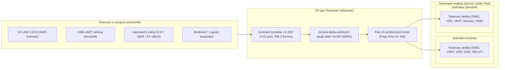

# DP-jigs – Testovací a programovací přípravek (Bed-of-Nails)

> Specializovaný hardwarový testovací přípravek s pružinovými kontaktními hroty (pogo pins) určený pro rychlé oživování, nahrávání firmwaru a funkční diagnostiku jednotek **Kontrola** a **Závodník**.

**Stav projektu:** `Dokončeno / Funkční` | **Hlavní technologie:** `KiCad 9, Pogo Pins (Bed-of-Nails), IDC 2×22, SWD/JTAG, UART`

---

## 1. Účel a funkce

Při sériovější výrobě a osazování prototypů diplomové práce je nutné desky rychle a spolehlivě oživit, zkontrolovat napájecí větve a nahrát zaváděcí firmware bez nutnosti pájení dočasných drátových přívodů nebo osazování objemných konektorů na finální miniaturní desky.

Projekt `DP-jigs` řeší tuto úlohu pomocí koncepce **Bed-of-Nails** (jehličkového pole):
- **Odpružené zkušební hroty (Pogo pins):** 41 jednotlivých zlacených pružinových hrotů (pozice `J4` až `J45`) přesně lícujících s testovacími ploškami na spodní straně desek `DP-Kontrola` (PRJ-10) a `DP-Zavodnik` (PRJ-11).
- **Centrální rozhraní IDC (J1):** Dvouřadý konektor IDC 2×22 pinů s roztečí 2.54 mm slouží k propojení se stolními přístroji:
  - programátorem a debuggerem **ST-Link V2 / V3** (rozhraní SWD – SWDIO, SWCLK, NRST),
  - USB-UART převodníkem pro sledování výpisů ze sériové konzole mikrokontroléru a komunikaci s modemem Quectel BC660K,
  - laboratorním napájecím zdrojem (napájení primární větve VBAT nebo USB VBUS 5V),
  - měřicími body pro osciloskop, multimetr nebo logický analyzátor.

---

## 2. Architektura a princip fungování



---

## 3. Technické parametry desky přípravku

| Parametr | Specifikace |
| :--- | :--- |
| **Typ desky** | 2vrstvá DPS (Nan-Ya NP-155FR core, JLCPCB stackup) |
| **Tloušťka DPS** | 1.6062 mm (zvýšená tuhost proti prohnutí při stlačení hrotů) |
| **Povrchová úprava** | HASL / ENIG pro spolehlivý kontakt pájecích plošek |
| **Konektor rozhraní** | 1× IDC Header 2×22 pinů vertikální, rozteč 2.54 mm (`J1`) |
| **Kontaktní hroty** | 41× zlacený pogo pin v pouzdře vertikálního kolíku (`J4`–`J45`) |
| **Fixace DUT desek** | Mechanické naváděcí kolíky pro přesné usazení desek z DP-Panelu |

---

## 4. Struktura adresáře

```text
.
├── DP-jigs.kicad_pcb                 # Návrh 2vrstvé desky testovacího přípravku v KiCad 9
├── DP-jigs.kicad_pro                 # Projektová konfigurace KiCad
├── DP-jigs.kicad_sch                 # Elektrické schéma zapojení (propojení J1 na pogo piny)
├── DP-jigs-layout.pdf                # Celkový osazovací a montážní výkres přípravku
├── DP-jigs-layout-part-1..4.pdf      # Detailní výkresy jednotlivých sekcí a kvadrantů
├── DP-jigs-view-1.png                # 3D fotorealistický render desky přípravku
├── fabrication-toolkit-options.json  # Exportní nastavení pro KiCad Fabrication Toolkit
├── production/                       # Výrobní podklady pro JLCPCB
│   ├── DP-jigs.zip                   # Archiv s Gerber vrstvami a Excellon vrty
│   ├── bom.csv                       # Kusovník součástek (J1 IDC lišta + pogo piny)
│   ├── positions.csv                 # Souřadnice pro strojní osazení konektoru a pinů
│   ├── designators.csv               # Seznam referenčních značek
│   └── netlist.ipc                   # IPC-D-356 kontrolní netlist
└── README.md                         # Tato dokumentace
```

---

## 5. Mapování signálů a konektoru J1

Schéma `DP-jigs.kicad_sch` definuje přímé vedení z pinů dvouřadého konektoru `J1` na jednotlivé odpružené hroty. Rozložení je rozděleno do funkčních bloků:

1. **Napájení a zem (Power & GND):**
   - Vícenásobné piny GND pro zajištění nízké impedance a spolehlivého návratového proudu.
   - Piny pro externí napájení větví 3.3 V (`VDD_MCU`), `VBAT` (simulace Li-Ion akumulátoru) a `VBUS_5V` (simulace USB napájení).
2. **Programovací rozhraní SWD (Serial Wire Debug):**
   - Vyvedeno pro kontrolér STM32WB55 jednotky Kontrola i Závodník (`SWDIO`, `SWCLK`, `NRST`, volitelně `SWO`).
3. **Komunikační sběrnice:**
   - UART TX/RX linky pro ladicí logy firmwaru.
   - Komunikační linky modemu BC660K pro přímou diagnostiku AT příkazů.
4. **Měřicí a stavové signály:**
   - Přístup k výstupům napěťových monitorů baterie a signálům bezdrátového Qi přijímače.

---

## 6. Doporučený postup oživování (Bring-up Workflow)

1. **Vizuální kontrola:** Před usazením testované desky do přípravku zkontrolujte, zda žádný z pogo hrotů není ohnutý nebo mechanicky zablokovaný.
2. **Připojení laboratorního zdroje:** Zdroj nastavte na 3.7 V (VBAT) nebo 5.0 V (VBUS) s proudovým omezením na max. 100 mA pro detekci případného zkratu na desce.
3. **Usazení testované desky:** Desku (oddělenou z `DP-Panel`) přiložte na naváděcí kolíky přípravku a rovnoměrným tlakem zajistěte kontakt všech testovacích bodů.
4. **Ověření napětí:** Multimetrem zkontrolujte výstupy regulátorů TPS62842 (3.3 V) a funkčnost PMIC obvodů.
5. **Flashování firmwaru:** Připojte ST-Link V2/V3 a nahrajte inicializační bootloader a aplikační kód ze složek `Kontrola_Syst` resp. `Zavodnik_Syst`.
6. **Funkční test:** Pomocí terminálu UART ověřte úspěšný start systému a vysílání rádiového majáku.

---

## 7. Návaznost na ostatní projekty

Projekt `DP-jigs` je v rámci repozitáře **DP** (`nagyjose/DP` / `nagyjose/master_thesis`) začleněn do složky testovacích prostředků `testing/`:
- **PRJ-10 (DP-Kontrola):** Primární testovaná jednotka základny.
- **PRJ-11 (DP-Zavodnik):** Primární testovaná jednotka závodníka.
- **PRJ-12 (DP-Panel):** Výrobní sestava, ze které desky pocházejí.
- **Kontrola_Syst / Zavodnik_Syst:** Firmwary v jazyce C vyvíjené a laděné pomocí tohoto přípravku.
